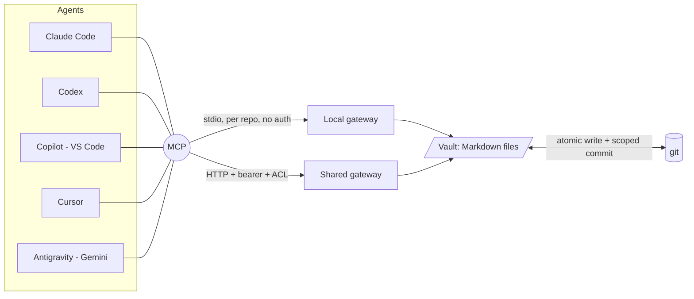
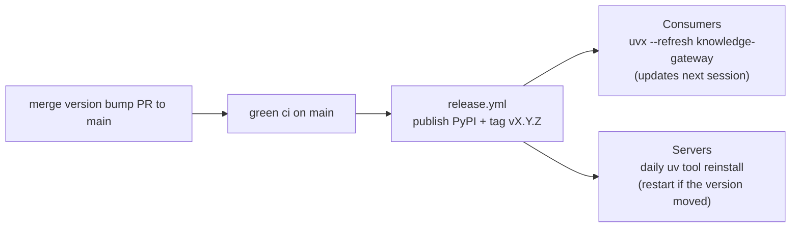

# knowledge-gateway

<!-- mcp-name: io.github.fszalaj/knowledge-gateway -->

A single MCP server that gives agents (Claude Code, Codex, Cursor, Copilot, Antigravity)
three capabilities over one connection:

- **Vault** - read, search, and **edit** a git-backed Markdown/Obsidian vault (no Obsidian GUI), git as the source of truth.
- **Code graph** - build and query a knowledge graph of a repo: definitions, imports and calls across ~30 languages (TypeScript/JavaScript, Go, Rust, Java, C#, C/C++, Ruby, PHP, Kotlin, Swift, Terraform/HCL and more) plus Python, and dedicated passes for the files a grammar cannot read as structure: Ansible (roles, playbooks, inventories, templates), Microsoft Fabric, Azure Bicep, Docker and compose, Kubernetes manifests and Helm charts, GitHub Actions, Appsmith apps, and dependency manifests (pyproject, requirements, package.json, .NET projects, Galaxy). Names and references only, never values. AST-only, local, no LLM.
- **Convert** *(`[convert]`)* - turn PDF / Office / image / HTML files into Markdown.

Install `knowledge-gateway[graph]` - the vault tools and the code graph. `[convert]` is separate
only because its PDF/Office parsers pull a materially larger, native-extension dependency tree.

The vault layer exists because the Obsidian *Local REST API* plugin serves only the one vault open
in a running desktop instance, writes without a lock (silent lost updates), needs a token in every
client, and treats git as secondary. This gateway operates on the files directly, with git as the
system of record - and serves the graph and convert tools over the same connection: one server,
no new servers to wire.

## Architecture



Both modes run the **same** tool implementation over the **same** path guards; they differ in
transport, authentication/ACL, vault loading, and error masking.

## Two ways to run

| | **Local mode** (per repo) | **Shared server** (team) |
|---|---|---|
| Use when | a repo wants its own vault for its agents | many people/vaults behind one always-on endpoint |
| Transport | stdio subprocess (launched by `.mcp.json`) | HTTP |
| Secrets / tokens | **none** - nothing to generate | per-user bearer tokens (admin-generated) |
| Trust boundary | local filesystem access you already have | per-user bearer token + per-vault ACL |
| Obsidian needed | no | no |

Most repos want **Local mode**. The shared server is for a central, always-on team gateway.

## Distribution - PyPI ("update once")

The gateway ships as a PyPI package, so a release reaches every consumer and server without
re-pinning anything by hand.



- **Consumers** run `uvx --refresh --from 'knowledge-gateway[graph]' knowledge-gateway` -> the
  latest release is resolved on every launch, so a new release auto-propagates the next time an
  agent starts. No per-repo re-pin.
- **Servers** (long-running) run `uv tool install 'knowledge-gateway[graph,convert]'` plus a
  daily job that reinstalls + restarts only when the published version actually moves.
- Every release is **also** an immutable `vX.Y.Z` git tag - pin `==X.Y.Z` when you need a
  frozen, auditable version.

### Branches

| Ref | What it is |
|---|---|
| `main` | development and the latest release. Every release is cut from a green `ci` here |
| `vX.Y.Z` | immutable tag per release, for a frozen or auditable pin |

The `stable` compatibility branch is retired with v0.12.0. Existing `@stable` requirements
must migrate to PyPI, preserving their extras and server arguments:
`uvx --refresh --from 'knowledge-gateway[graph]' knowledge-gateway --local`.
Persistent servers use `uv tool install 'knowledge-gateway[graph,convert]'` and their configured
updater. Pin `==X.Y.Z` for a fixed package version. Running development `main` does not track
published releases.

## Quickstart - local mode (zero secrets)

Add this to the repo's `.mcp.json` at the repo root:

```jsonc
{
  "mcpServers": {
    "wiki": {
      "command": "uvx",
      "args": ["--refresh", "--from", "knowledge-gateway[graph]",
               "knowledge-gateway", "--local"]
    }
  }
}
```

- `--local` auto-detects the vault in the cwd, in order: the cwd itself if it has `.obsidian/`,
  then `./wiki`, then a single `*-obsidian-vault/`, then a single child dir with `.obsidian/`
  (ambiguous matches error). Pass `--vault ./<dir>` to be explicit.
- `--refresh` re-resolves the latest release each launch, so releases auto-apply (adds ~1-2s to start).
- Commits are scoped to the vault's git subdir and attributed to your own
  `git config user.name/email`. No token: the trust boundary is local filesystem access.

Open the repo in your agent, approve the `wiki` server once, done.

## Tools

| Tool | |
|---|---|
| `list_vaults` | vaults reachable here |
| `list_notes` | Markdown paths in a vault |
| `read_note` | raw note content |
| `list_attachments` / `read_attachment` | list / read binary attachments (image -> inline Image, else an embedded resource carrying the file's real media type) |
| `list_canvases` / `read_canvas` / `write_canvas` | list / read / write Obsidian Canvas (nodes, groups, colors) |
| `search` | ripgrep literal/regex full-text |
| `backlinks` | notes that `[[wikilink]]` to a note |
| `list_tags` | inline `#tags` with counts |
| `query_notes` | find notes by frontmatter `type` / `tag` (headless Dataview-lite) |
| `write_note` | atomic write (+ optional commit) |
| `patch_note` | insert after a heading or at top/bottom, no full rewrite (+ commit) |
| `patch_frontmatter` | update YAML frontmatter keys, body intact (+ commit) |
| `delete_note` | delete a note (+ optional commit) |
| `rename_note` | rename/move + rewrite inbound flat `[[wikilinks]]` when the name changes (+ optional commit) |
| `git_status` / `git_commit` | pending changes / commit (subdir-scoped, attributed) |
| `list_graphs` / `graph_query` / `graph_neighbors` / `god_nodes` / `graph_shortest_path` / `graph_stats` | query a built code graph. `list_graphs` and `graph_stats` also report where each snapshot came from - the revision, the build time, and whether the file still matches its manifest |
| `graph_build` | build a code graph from a source tree into `.graph/<name>.json` (local mode only) |
| `convert_to_markdown` | convert a document in the vault to Markdown (needs `[convert]`). Allowlisted types only - PDF, Office, image, HTML, CSV, EPUB, Outlook, audio/video - so a token that may read notes cannot read an arbitrary file that happens to sit in a vault; anything else is `not_convertible` |

Note writes are atomic (temp file + `rename`) and use `safe_note_path`. Attachments, canvases,
conversion inputs and graph files use their own type-specific containment guards. Together they
block traversal, symlink escape and access outside the configured vault.

## Agent skills

The repository includes a validated, provider-neutral Agent Skills pack under `.agents/skills/`,
a real directory that Codex, Gemini CLI, GitHub Copilot and Cursor discover natively. Claude Code
reads the same files through the repository plugin in `.claude-plugin/`. Agent instructions follow
the same rule: `AGENTS.md` is canonical, and `CLAUDE.md` / `GEMINI.md` are regular files that
import it. The repository tracks no symlinks, so a Windows checkout without Developer Mode (or any
`core.symlinks=false` checkout) gets the full instructions and skills.
Consumer repositories can instead own copies in their documented project-level directory.

The pack covers:

- `gateway-setup` and `gateway-operations` for configuration, verification, operation and release;
- `code-graph-build`, `code-graph-explore` and `code-impact` for architecture discovery and
  blast-radius analysis;
- `wiki-query`, `wiki-curate`, `wiki-ingest`, `wiki-lint`, and `wiki-fold` for durable knowledge;
- `canvas` and `obsidian-markdown` for Obsidian-native authoring;
- `document-convert` for reviewed PDF and Office conversion; and
- `cordis-composability` for reversible effects and declared dependencies.

Skills add repeatable procedures, not privileges. Server-side ACLs, path guards, hooks and CI remain
the enforcement layer. The machine-readable inventory is `.agents/skills/manifest.json`; CI
validates that every skill is registered and references only real gateway tools, that the plugin
manifest points at the pack at the package version, and that git tracks no symlinks. The source
distribution keeps shipping the pack under `skills/`.

**Claude Code quickstart.** Claude Code discovers project-level skills only in `.claude/skills`,
so it loads this pack from the plugin manifest once you opt in; skills then appear as
`/knowledge-gateway:<skill>`. From the repository root (recommended; the plugin is read in
place, so skill edits apply immediately):

```bash
claude --plugin-dir .
```

A persistent install is possible when you keep exactly one clone per OS user:

```bash
claude plugin marketplace add ./ --scope local
claude plugin install knowledge-gateway@knowledge-gateway --scope local
```

The marketplace registration is per OS user, not per clone: running these commands in a second
clone re-points the plugin of every clone at that second clone. The install records the clone's
absolute path in `~/.claude/plugins/` and the git-ignored `.claude/settings.local.json`, and copies
the whole working tree (untracked files included) into `~/.claude/plugins/cache/`, so do not keep
secrets in the checkout when you install. Do not use `--scope project`: it rewrites the committed
`.claude/settings.json` with an absolute path.

Copy selected skills into the destination listed in the sourced compatibility table:

```bash
mkdir -p ../consumer/.agents/skills
cp -R .agents/skills/wiki-query .agents/skills/wiki-curate ../consumer/.agents/skills/
```

Copy on a branch, do not overwrite an existing same-name skill blindly, and review the consumer
diff. The copied files are then owned and versioned by the consumer repository.

See [`docs/agent-skills.md`](docs/agent-skills.md) for the compatibility matrix, required extras,
workflow harness, maintenance rules and security boundaries.

For the complete pack, run local mode with every capability, conversion included:

```jsonc
{
  "mcpServers": {
    "wiki": {
      "command": "uvx",
      "args": [
        "--refresh",
        "--from",
        "knowledge-gateway[all]",
        "knowledge-gateway",
        "--local"
      ]
    }
  }
}
```

The dependency-free core quickstart above remains the preferred setup when only vault operations
are needed.

## Code graph and conversion

Install profiles. The core vault tools need no third-party parser at all; the code graph ships
in the recommended `[graph]` install, and conversion is separate because its PDF/Office parsers
pull a materially larger, native-extension dependency tree:

| Install | What you get |
|---|---|
| `[graph]` | the code graph and its query tools, over **every supported language**: a tree-sitter pass across ~30 grammars (JS/TS/TSX, Go, Rust, Java, C#, C/C++, Ruby, PHP, bash, PowerShell, Terraform/HCL, Lua, Kotlin, Swift, Scala, R, Perl, Elixir, Clojure, Dart, SQL, Groovy, Julia, Solidity, Haskell, OCaml) plus Python via the stdlib `ast`, plus the dedicated passes below (Ansible, Microsoft Fabric, Azure Bicep, Docker, Kubernetes/Helm, GitHub Actions, Appsmith, dependency manifests, Jenkins, AWS Elastic Beanstalk, HTTP request files, ASP.NET Core endpoints) |
| `[graph-slim]` | the same tools with **only** the dependency-free extractors: Python and every dedicated pass below (they need the stdlib and PyYAML, never tree-sitter). Pick this only when the parser pack is not worth its size; without it, bash, PowerShell, C# and the other grammars get no definitions, though a dedicated pass still emits the `module:<rel>` node of a script it references |
| `[graph-all]` | alias of `[graph]`, kept so older pins keep resolving |
| `[convert]` | attachment -> Markdown via MarkItDown; opt-in PDF and Office parsers add a materially larger dependency tree, including native-extension packages |
| `[all]` | `[graph]` + `[convert]` in one pin - the whole toolset, and the string to use when a config should not drift apart from what the CLI has installed |

### Microsoft Fabric

A git-integrated Fabric workspace is mostly JSON and TMDL. Parsing that as *JSON* would emit a node
per key and answer nothing, so there is a dedicated pass that reads the shapes Fabric writes:

| Read | Emitted |
|---|---|
| `<Name>.<Type>/.platform` | `fabric:<Type>:<displayName>` - identity from the descriptor, including `logicalId` |
| `<Name>.DataPipeline/pipeline-content.json` | one node per activity (nested `ForEach`/`If` included), `depends_on` for order, `invokes` for what each one runs |
| `<Name>.SemanticModel/definition/**/*.tmdl` | tables and the measures under them |
| `<Name>.Report/definition.pbir` | `reads_model` -> the semantic model |
| `<Name>.Notebook/notebook-content.py` | `implemented_by` -> the `module:` node the Python pass produced |

That last edge is the point: it joins the artifact map to the code graph, so "what breaks if I
change this notebook" is one query rather than two graphs and a guess. References resolve by
logical id where Fabric writes one and by display name where it does not - both occur in real
exports.

Deliberately absent: notebook -> lakehouse table lineage. That needs heuristics over Spark code
rather than structure, and a wrong guess there is an edge that looks authoritative and is not.

### Infrastructure, CI and app passes

The same idea covers the rest of a deployment repository. Each of these is a repo-level pass
(stdlib + PyYAML only, so it runs under `[graph-slim]` too), and they share one contract:

- **Names, never values.** No variable, parameter or environment *value*, no default, no
  Secret `data`, no datasource URL, header or body, no inventory variable reaches the graph -
  only the names and keys that give it structure. Each pass has a test that plants a unique
  secret-looking value everywhere a value can sit and asserts it appears nowhere in the output.
- **One id per file.** When a pass references a file another pass owns, it uses that pass's id
  (`module:<rel>` for code and scripts, `playbook:<rel>`, `dockerfile:<rel>`, `manifest:<rel>`,
  `project:<rel>`), so a CI job, the script it runs and the image that script builds are one
  path through the graph, not three islands.
- **Structure only.** No template evaluation (Helm, Jinja, Bicep, `${{ }}`), no network, no
  registry lookup, no subprocess. Directories are pruned with the rule above, walks are sorted,
  a symlink is never followed out of the root, files over 2 MiB are skipped, and a malformed
  or unreadable file is skipped rather than failing the build. Heuristic edges are `INFERRED`.

`graph_stats` reports which passes ran in `passes`, with the number of nodes each one emitted
(`-1` when a pass raised on input it did not foresee: its output is left out and the build
goes on). The graph keeps one edge per pair of nodes; when a pair is related in more than one
way (a stage that copies a script and then runs it), the edge lists every relation in
`relations`, and `graph_neighbors` returns that list too.

A few joins need both ends at once, and no single pass sees both. These run once, after every
fragment is merged and before communities are computed, as **post-merge links**: they read node
attributes only, add `INFERRED` edges between nodes that already exist (never a node), and are
deterministic. `graph_stats` reports them in `links`, as the number of node pairs each one
joined (`-1` when it raised: its edges are left out, the build goes on). See `calls_api` under
ASP.NET Core below.

**Ansible** - extended beyond roles:

| Read | Emitted |
|---|---|
| any `*.yml`/`*.yaml` list whose plays carry `hosts` or `import_playbook` | `playbook:<rel>`, `imports_playbook`, `targets` -> the inventory group or host a play names (`INFERRED` when no inventory here defines it) |
| `template` / `copy` tasks | `renders_template` -> `template:<rel>`, `copies_file` -> `file:<rel>` (or the `module:<rel>` of copied code), resolved the way Ansible searches |
| INI and YAML inventories | `invgroup:<name>`, `invhost:<name>`, `member_of`, `child_of` |
| `group_vars/` and `host_vars/` | `vars:<rel>` -> `configures` the group or host; the files are never parsed |

Absent: every variable name and value, `[x:vars]`, inline host variables, `copy: content:`,
vault payloads (a `!vault` tag parses to nothing), dynamic inventory and host-pattern evaluation.

**Azure Bicep**:

| Read | Emitted |
|---|---|
| `*.bicep` | `bicep:<rel>`, and per declaration `bicepparam:`, `bicepoutput:`, `bicepresource:` (nested `parent::child` included, with resource type and API version), `bicepmodule:`; `uses_module` -> `bicep:<rel>` or `extbicep:<registry ref>`, `imports`, `child_of`, `depends_on` (`EXTRACTED` from `dependsOn`, `INFERRED` from symbolic references) |
| `*.bicepparam` | `parameterizes` -> its `using` template, `extends`, `sets_param` -> the template param it assigns (the name, never the value) |
| `getSecret(...)`, `@Microsoft.KeyVault(...)`, secret URLs | `reads_secret` -> `kvsecret:<vault>/<secret>` by name |
| `az deployment ... create\|what-if\|validate`, `az stack`, `New-/Test-Az*Deployment` in scripts | `deploys` from the script's `module:<rel>` to the template and parameter file, with `operations` |

Absent: param defaults, `.bicepparam` assignments, var bodies, property values, descriptions,
tags; no compilation and no registry lookup.

**Docker and compose**:

| Read | Emitted |
|---|---|
| `Dockerfile`, `Containerfile`, `*.Dockerfile`, `Dockerfile.*` | `dockerfile:<rel>`, `dockerstage:<rel>#<stage>`, `based_on` -> `extimage:<name[:tag]>` or a prior stage, `copies` / `copies_from`, `runs` -> the copied file an `ENTRYPOINT`/`CMD`/`RUN` executes |
| `compose*.y[a]ml`, `docker-compose*.y[a]ml` | `compose:<rel>`, `composeservice:<rel>#<service>`, `uses_image`, `builds_from`, `targets_stage`, `depends_on`, `mounts` (bind mounts), `uses_env_file` |
| `docker\|podman build/push` in scripts | `builds` (`INFERRED`: the build context is a guess) and `pushes` |

Absent: `ENV`/`ARG`/`--build-arg`/`environment` values (names only), `env_file` contents (never
read), labels, `RUN` text, secrets/configs, remote build contexts; `${VAR}` is never expanded.

**Kubernetes and Helm**:

| Read | Emitted |
|---|---|
| `Chart.yaml`, `Chart.lock`, `requirements.yaml` | `helmchart:<dir>`, `depends_on` -> a local chart or `exthelmchart:<repo>/<name>` (credentials stripped from repository URLs) |
| chart `templates/**` (scanned tolerantly, never rendered) | `helmres:<chart>/<Kind>/<name>`, `renders`, `reads_value` -> `helmvalue:<chart>/<top-level key>` |
| `values.yaml` and environment overlays | `helmvalues:<file>`, `default_values_of`, `overrides` (`INFERRED` from name and location), `defines_value` |
| `helm install\|upgrade` in scripts | `helmrelease:<ns>/<name>`, `deploys` from the script's `module:<rel>`, `installs`, `uses_values` (with `-f` order) |
| plain manifests and `kustomization.yaml` | `k8sres:<ns>/<Kind>/<name>`, `kustomization:<file>`, `includes`, `generates`, `selects` (`INFERRED` by labels), `routes_to`, `uses_secret` / `uses_configmap` / `uses_service_account` / `uses_pvc`, `binds_role`, `binds_subject` |

Absent: Secret and ConfigMap data, env values, `--set` arguments, values-file values (top-level
key names only), kustomize literals and `valuesInline`, labels; no Helm rendering, no remote
bases. A YAML list (an Ansible playbook) is never read as a manifest.

**GitHub Actions** (read from `.github/` directly, although the prune rule hides it; naming
`.github` in `--exclude` turns the pass off):

| Read | Emitted |
|---|---|
| `.github/workflows/*.y[a]ml` | `ghworkflow:<rel>`, `ghjob:<rel>#<job>`, `contains`, `depends_on` (`needs`), `calls_workflow` -> `ghworkflow:` or `extworkflow:` |
| `uses:` | `uses_action` -> `ghaction:<dir>` (local) or `extaction:<owner>/<repo>` (the ref is an edge attribute) |
| `${{ secrets.X }}`, `${{ vars.X }}` | `uses_secret` -> `ghsecret:<NAME>`, `uses_var` -> `ghvar:<NAME>` |
| `run:` shell lines | `runs_script` (`INFERRED`) -> the `module:`, `playbook:` or `dockerfile:` node of the file it runs, `file:<rel>` otherwise |

Absent: every `env:`, `with:`, matrix, input-default and environment-URL value, container and
service images; no expression is evaluated and no remote action is fetched.

**Appsmith** (a git-synced export, found by its `metadata.json` marker):

| Read | Emitted |
|---|---|
| `application.json`, `pages/<page>/` | `appsmith:<app>`, `appsmithpage:<app>/<page>`, `contains`, `navigates_to` |
| `widgets/**.json` | `appsmithwidget:<app>/<page>/<widget>` nested by parent (layout canvases collapsed) |
| `queries/<q>/` and `datasources/` | `appsmithquery:` (plugin, HTTP method, the *shape* of the URL path: bindings and every segment that is not a plain word become `{}`, since tokens are often carried in the path; `route_shape` is that shape in the canonical form the HTTP and ASP.NET passes share, one leading `/` and no trailing one), `appsmithdatasource:` (plugin only), `uses_datasource` |
| `{{ }}` bindings and `jsobjects/` | `triggers` (`<Query>.run()`, `<JS>.<fn>()`), `reads` (`<Query>.data`), `references` (`INFERRED`), `implemented_by` -> the `.js` file's `module:<rel>` |

Absent: datasource configuration (URLs, credentials, auth), headers, bodies, query parameters,
hosts and query strings, widget text and defaults, JS code.

**Dependency manifests**:

| Read | Emitted |
|---|---|
| `pyproject.toml`, `requirements*.txt`, `package.json`, Galaxy `requirements.y[a]ml` | `manifest:<rel>`, `depends_on` -> `extpackage:<pypi\|npm\|galaxy>:<name>` (version specifier and scope as attributes), `includes` / `constrained_by` for `-r` / `-c` |
| `*.csproj` (any `*proj`), `*.sln`, `*.slnx` | `project:<rel>`, `solution:<rel>`, `depends_on` -> `extpackage:nuget:<id>`, `references_project`, `contains` -> the `module:<rel>` of each `.cs` file (`INFERRED` from the SDK glob) |

Absent: index URLs and other pip options, direct-reference and git URLs (reduced to the package
name plus an `origin`), MSBuild property values such as `UserSecretsId`, lock files; nothing is
resolved against a registry. A Galaxy requirement `provides` (`INFERRED`) the `role:<name>` a
playbook references by that name (a collection `ns.coll` provides `ns.coll.<role>`), so a role
that is installed rather than vendored is typed instead of dangling.

**Jenkins** (`Jenkinsfile`, `Jenkinsfile.*`, `*.jenkinsfile`, `*.groovy` and files named for
Jenkins other than documentation such as `.md` / `.rst` / `.html`, kept only when they hold a
`pipeline {}` or `node {}` block; a linear Groovy tokenizer, never evaluated):

| Read | Emitted |
|---|---|
| declarative `pipeline { stages { ... } }` and scripted `node { stage(...) }`, shared-library `def call()` | `jenkinspipeline:<rel>`, `jenkinsstage:<rel>#<stage path>`, `contains` (nested and `parallel` stages), `depends_on` -> the previous stage in sequence (`EXTRACTED` declarative, `INFERRED` scripted) |
| `credentials('id')`, `withCredentials([...])`, `registryCredentialsId` | `uses_credential` -> `jenkinscredential:<id>` (the id; `via` names the binding or step, `variable` the `environment` name a `credentials('id')` fills) |
| `agent { docker / dockerfile }`, `docker.image().inside`, `docker build/push`, `docker.build()` | `uses_image` / `pushes` -> `extimage:`, `builds` -> `dockerfile:<rel>` |
| `sh` / `bat` / `powershell` / `load` steps | `runs_script` (`INFERRED`) -> the `module:<rel>` / `file:<rel>` it runs, resolved through `dir()` / `cd` |
| `helm upgrade\|install`, `eb deploy`, `aws elasticbeanstalk update-/create-environment`, `dotnet eb deploy-environment`, `dotnet build\|publish\|test` | `deploys` -> `helmrelease:<ns>/<name>` (the k8s pass's id) or `beanstalkenv:<app>/<env>` (the Beanstalk pass's id and name rules, with `beanstalkapp:<app>` `has_environment` when the application is named), `installs` -> a local `helmchart:`, `builds` / `tests` (`dotnet test`) -> `project:<rel>` |

Absent: every environment and parameter *value* (names only), credential secrets, `--set` and
option values, URLs, hosts, headers and bodies (`httpRequest` is not read), shell text, `build
job:` triggers, shared-library fetching.

**AWS Elastic Beanstalk** (read in place from each directory: `.ebextensions`, `.platform` and
`.elasticbeanstalk` stay pruned from the walk, and naming one in `--exclude` turns that part off;
`bin/` and `obj/` beside a .NET project are build output and pruned too, unless `--include`d):

| Read | Emitted |
|---|---|
| `.ebextensions/*.config` (YAML or JSON) | `beanstalkbundle:<dir>`, `beanstalkconfig:<rel>` (option namespaces and `<ns>/<option>` names, environment-variable names, package / service names, command names), `beanstalkresource:<rel>#<LogicalId>`, `defines_resource`, `depends_on`, `runs_script` (`INFERRED`) -> the bundle script a command invokes |
| `.elasticbeanstalk/config.yml`, `aws-<tool>-tools-defaults*.json` | `beanstalkcli:`, `awsdeploydefaults:`, `beanstalkapp:<app>`, `beanstalkenv:<app>/<env>`, `targets`, `deploys_to`, `configures` -> `project:<rel>` |
| `.platform/hooks\|confighooks/<phase>/*`, `Procfile`, `Dockerrun.aws.json` | `runs` (hook, phase), `beanstalkprocess:`, `dockerrun:`, `dockerruncontainer:`, `uses_image` -> `extimage:`, `links` |

Absent: every `option_settings` value, command text, `env` / `cwd` / `test`, file contents and
sources, package versions and URLs, resource properties and outputs, Dockerrun auth, volumes and
environment values, Procfile commands, and every defaults-file value except the application,
environment, solution stack, project path and a plain region code.

**HTTP request files** (`*.http`, `*.rest`: VS Code REST Client, JetBrains HTTP Client, Visual
Studio):

| Read | Emitted |
|---|---|
| request blocks (`###`), `# @name`, `METHOD URL` | `httpfile:<rel>` (file-variable names), `httprequest:<rel>#<name or position>` with method, `route_shape`, header names, `uses_auth`, variable and prompt names, `has_request` |
| `{{name.response...}}`, `< ./body.json`, `> ./check.js`, `import` / `run` | `uses_response`, `body_from` / `runs` -> the file's `module:<rel>` / `file:<rel>`, `imports` |

`route_shape` follows the Appsmith rule: the query string and fragment are cut first, then
scheme, userinfo, host and port (the first segment of a scheme-less URL is its host) and a
leading `{{base}}` binding are dropped, and a binding inside the path becomes `{}`. A leading
file variable that holds a URL (`@base = https://h/api/v2`) is substituted only as one `{}` per
path segment it contributes (`GET {{base}}/items` -> `/{}/{}/items`), so no part of its value
reaches the graph. Absent: every file-variable, header and body value, auth schemes, query
strings and parameter names, comments and `###` titles, inline `` scripts; environment
files are never read.

**ASP.NET Core** (`*.cs`, a linear C# tokenizer; no compiler, `bin/` and `obj/` pruned):

| Read | Emitted |
|---|---|
| controllers (`[ApiController]`, `*Controller`, `ControllerBase`) with `[Route]`, `[Http*]`, `[AcceptVerbs]`, `[Area]`, `[ApiVersion]` | `endpoint:<METHOD> <route shape>` (kind, controller, action, `auth` required\|anonymous), `handled_by` -> the `.cs` file's `module:<rel>` |
| minimal APIs: `MapGet` / `MapPost` / ... / `MapMethods` / `Map` (not the `app.Map("/x", b => b.Run(...))` middleware branch), `MapGroup` prefixes, `RequireAuthorization` / `AllowAnonymous` | the same `endpoint:` nodes; `optional_segments` counts trailing `{id?}` / `{id=1}` / `{*rest}` segments a caller may omit |
| the enclosing `*.csproj` (located, not parsed) | `aspnetapp:<project dir>`, `exposes`, `defined_by` -> `project:<rel>` |

Post-merge link `calls_api` (`INFERRED`): an `appsmithquery:` or `httprequest:` node calls the
`endpoint:` with the same method (or `ANY`) whose route shape it matches; the `match` attribute
says how - `exact`, `pattern` (a `{}` on either side stands for one segment) or `suffix` (the
client path ends the endpoint route, its leading base-URL `{}` segments dropped). At least one
literal segment must match, literals compare case-insensitively as ASP.NET routing does, and a
client with more than four equally good candidates gets no edge. Clients and endpoints join only
inside one graph, so a UI and the API it calls built as separate graphs do not link.

Absent: `[Authorize]` policy and role names, constant values, `appsettings*.json`, header names
and values, bodies, conventional routes (`MapControllerRoute`), actions without a route or verb
attribute, inherited actions, interpolated templates, Razor Pages, gRPC, SignalR, Functions.

**Build a graph** (AST-only - local, no network, no LLM) where the code lives:

```bash
knowledge-gateway-graph /path/to/code-repo -o /path/to/vault/.graph/myrepo.json
# in a local-mode session the graph_build tool does the same, writing .graph/<name>.json
```

Both write a `<name>.meta.yaml` sidecar beside the snapshot: the source revision, the build
time and the snapshot's SHA-256. A graph is a snapshot and cannot refuse to be stale, so that
provenance travels with the answer - `list_graphs` carries each snapshot's revision and build
time, and `graph_stats` adds `snapshot_matches`, false when the snapshot changed after its
manifest was written. The sidecar holds no absolute path, only the source directory's basename.

Hidden directories (`.git`, `.next`, `.venv`, caches, ...) and common build/vendor output
(`node_modules`, `dist`, `build`, `target`, `vendor`, ...) are always skipped.
`--exclude <name> ...` adds directory names to skip; `--include <name> ...` force-keeps
names the rule would skip (e.g. `.github`, a first-party `vendor/`). Matching is by
directory basename, not path or glob. Same `exclude`/`include` on the `graph_build` tool.

**Query it** over MCP with `graph_query` / `graph_neighbors` / `god_nodes` /
`graph_shortest_path` / `graph_stats`. The graph captures functions, classes, imports and calls
in every supported language.

Ansible gets its own extractor rather than a grammar, because a playbook is YAML: a parser sees
mappings and lists, not structure. That pass reads the *semantics* - roles, tasks, handlers,
`include_role` / `import_tasks` / `notify`, `task -> filter plugin` edges, and the playbook,
inventory and template wiring described above - so an Ansible tree becomes a call graph like
any other repo. Graph files live in the vault's `.graph/` and are vault-contained
(resolved + checked to stay inside the vault). Query tools are read-only; local `graph_build`
deliberately creates or replaces the selected graph artifact. Vault note tools never depend on it.

## Shared server mode

Run this only for a central, always-on gateway reachable over the network.

**1. Map vaults** - `cp vaults.example.yaml vaults.yaml`, then set `name -> path / repo_root /
subdir`. `repo_root` + `subdir` pathspec-scope commits to a vault that lives inside a larger repo.

**2. Mint a token per user** (the admin does this):

```bash
cp tokens.example.yaml tokens.yaml
openssl rand -hex 32          # once PER user -> the key
chmod 0600 tokens.yaml        # refused at load if group/world-readable
```

```yaml
tokens:
  "8f3c…hex…":
    sub: alice                # identity recorded on that user's commits
    vaults: [teamwiki]        # the ONLY vaults this token may see/touch
    write: true               # false = read-only
```

A token sees only the vaults in its `vaults` list; anything else returns an opaque
`vault_forbidden`. `vaults.yaml` + `tokens.yaml` are gitignored.

**3. Run** - `uv run knowledge-gateway` (127.0.0.1:8765, path `/mcp/`). For a team box, run it as
a service - see `deploy/` and *Operate* below.

**4. Connect** - the admin shares the token over a password manager (not chat). Replace this
example endpoint with your gateway's MCP URL:

```bash
claude mcp add --transport http --scope project teamwiki \
  https://gateway.example.com/mcp/ --header "Authorization: Bearer $GW_TOKEN"
```

## Security model

- **No secrets in the repo.** `vaults.yaml` / `tokens.yaml` are gitignored; only
  `*.example.yaml` ship. `tokens.yaml` is refused at load if group/world-readable.
- **Local mode has no credential surface** - a local stdio subprocess; the trust boundary is
  filesystem access the user already has.
- **Server mode authenticates each user** with a `StaticTokenVerifier` bearer token and
  enforces per-vault ACLs. Its vault list and write flag determine what the user may access or change.
- **Path guards on all note I/O** via `safe_note_path` (traversal, symlink, hidden/dotfiles
  incl. `.env`, non-`.md`, `.git`/`.obsidian`). Search/backlinks/tags are bounded to `*.md`.
- **Server-mode error masking** - the HTTP server runs `mask_error_details=True`: only the
  gateway's own expected failures surface as `ToolError`; unexpected OS/git errors are hidden.
  Local mode keeps details visible.
- **Commits are attributed** to the requesting user (server) or the local git identity (local),
  and pathspec-scoped to the vault subdir.

## Set it up with an AI

Paste this into an agent at a repo's root to wire in local mode:

```
Add the knowledge-gateway to this repo so agents can read/edit our vault over MCP with zero
tokens:
1. Create or merge `.mcp.json` at the repo root with an mcpServers."wiki" entry that runs:
   uvx --refresh --from 'knowledge-gateway[graph]' knowledge-gateway --local
   (`--local` auto-detects the vault: ./wiki, a *-obsidian-vault dir, or a dir with .obsidian/.
   If detection is ambiguous, use `--vault ./<vault dir>` instead of `--local`.)
2. Verify: `uvx --refresh --from 'knowledge-gateway[graph]' \
   knowledge-gateway --help` resolves; then in the agent, call list_vaults and read one note.
Branch + PR, no direct push, no AI attribution.
```

For the shared server, ask your gateway admin for a token, then run the `claude mcp add …` from
*Connect* above.

## Operate (servers)

A server runs the latest release as a `uv tool`, with a daily job that reinstalls and
restarts only when the **published version** changes. Reference units are in `deploy/`:

```bash
uv tool install 'knowledge-gateway[graph,convert]'
# the binary lives in the uv cache, so point config at the live files via env:
#   KNOWLEDGE_GATEWAY_VAULTS= <dir>/vaults.yaml   KNOWLEDGE_GATEWAY_TOKENS= <dir>/tokens.yaml
```

- `deploy/knowledge-gateway.service` - the service (systemd `--user`).
- `deploy/knowledge-gateway-update.{service,timer}` + `deploy/auto-update.sh` - the daily auto-update.

Update now instead of waiting for the timer:
`uv tool install --reinstall 'knowledge-gateway[graph,convert]'`, then restart the service. Health: `curl -s -o /dev/null -w '%{http_code}' http://127.0.0.1:8765/mcp/` -> `401`.

## Release (maintainers)

Releasing is a version bump, nothing else. `release.yml` watches for a **green `ci` run on
`main`** whose `pyproject.toml` version has no tag yet, and then does the rest by itself:
build, publish to PyPI (Trusted Publishing, no token), then create the `vX.Y.Z` GitHub Release
and immutable tag. No distribution branch is created or moved.

Merging code without a version bump leaves it unreleased. The release workflow can finish
successfully while skipping publication when the version's tag, published GitHub Release and
matching PyPI artifacts already exist.

1. Move `Unreleased` changelog entries into the new version section and bump the version in
   `pyproject.toml`, `server.json` and `.claude-plugin/plugin.json`.
2. Run `uv lock` so the lockfile carries the new version, plus the skill validator and the test
   suite. Open a PR; merge only after the Python 3.11-3.13 CI matrix is green.
3. Watch the `release` run. Verify the source commit, immutable tag and matching wheel/sdist
   digests on PyPI and the GitHub Release.

The tag is created **after PyPI publishing**. GitHub assets use the verified bytes downloaded
from PyPI, with their runtime sources checked against the release tree. An incomplete tagged
release resumes from that tag; published assets with conflicting digests are refused.
If PyPI has the version but its tag is absent, automatic publication stops. Inspect the original
workflow and its source evidence before recovering the immutable tag and retrying. A later
commit must not claim an already published version. Pushing a `vX.Y.Z` tag by hand remains
supported and checks that the tag matches the packaged version.

Consumers pick it up next session; servers within a day (or restart now).

## Develop

```bash
uv venv && uv pip install -e ".[dev]"
uv run pytest                              # ACL + path guards + edit/frontmatter + detect + masking
```
